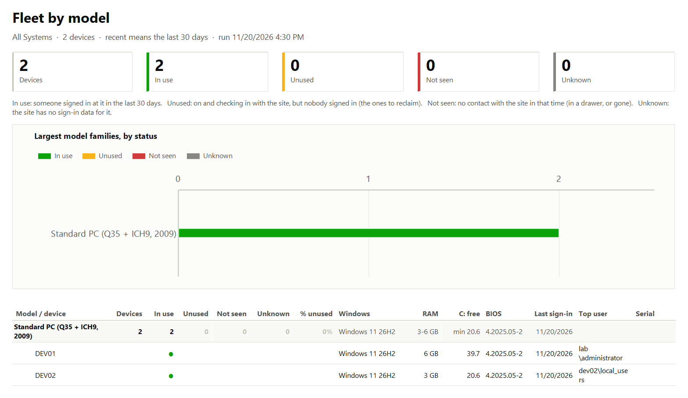
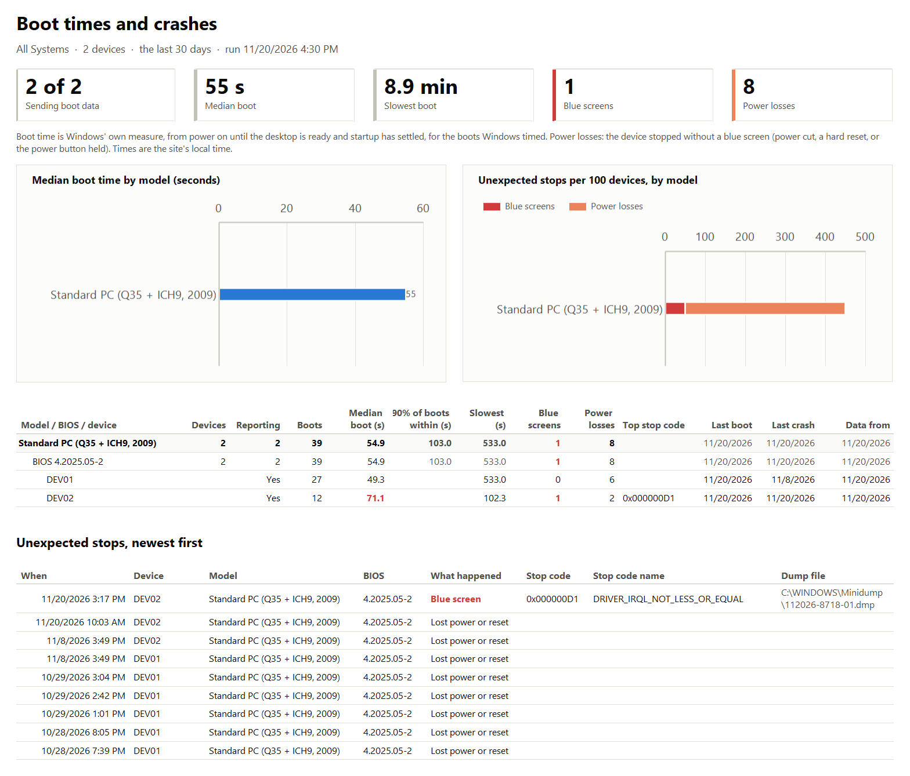
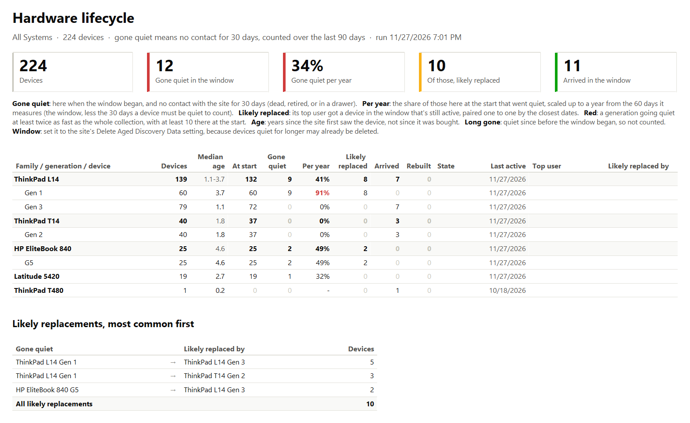
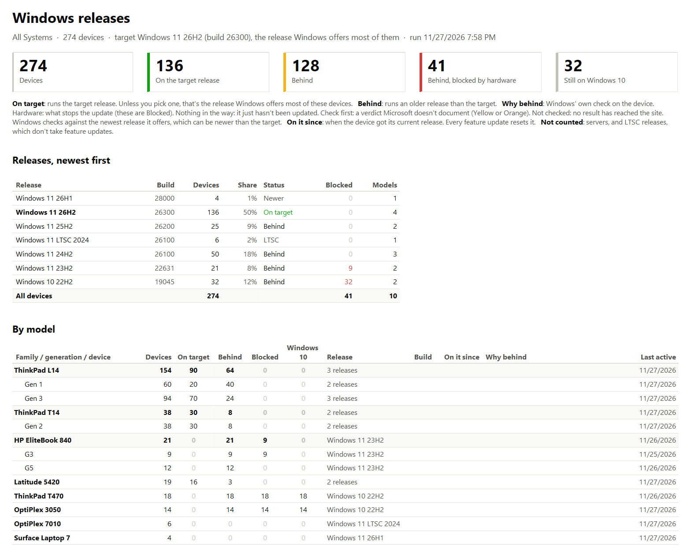
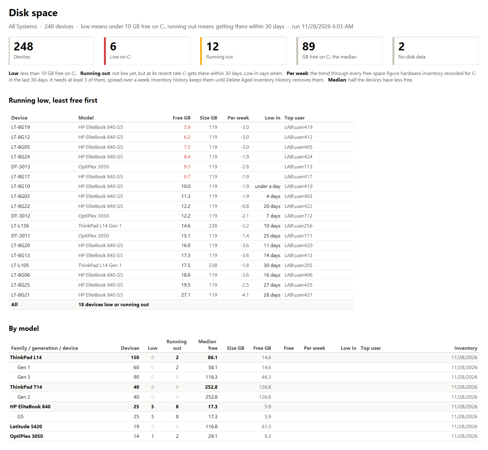

# layer8-reports

ConfigMgr reports on how your Windows fleet treats the people using it: model generations, idle hardware, app usage, boot times, crashes and hardware health. A companion to [Layer8](https://github.com/JBoogieman/layer8).

The reports run in your own ConfigMgr report server, next to Microsoft's. They respect each reader's security scopes the same way Microsoft's reports do. Each one says at its foot how current the hardware inventory behind it is: the newest, the median age, and how many devices haven't sent any.

## Reports

### Fleet by model

Devices in a collection, grouped by model family and generation, so ThinkPad L14 Gen 1 through Gen 6 sit side by side. For each family, each model and each device:

- **In use:** someone signed in at it recently.
- **Unused:** it's on and checking in with the site, but nobody signs in. These are the ones to reclaim.
- **Not seen:** no contact with the site recently. It's in a drawer, or gone.
- **Unknown:** the site has no sign-in data for it.

You choose what counts as recent (30 days by default), and whether every device is listed from the start or only when you open its model ("Show every device", handy for a PDF). Beside the counts: the Windows release (by name, like 24H2), RAM, the lowest free space on C:, BIOS versions (a model running three different BIOS versions says so), last sign-in, top user and serial number. A chart shows the largest families by status.

Lenovo reports a machine type code (21C5...) as the model. The report uses the name people know instead ("ThinkPad L14 Gen 3"), from the same inventory.

Uses only ConfigMgr's default hardware inventory, so it works on any site without changing client settings. Its query is in [reports/FleetByModel/FleetByModel.sql](reports/FleetByModel/FleetByModel.sql).



### Boot times and crashes

How long devices take to start and how often they stop unexpectedly, by model and BIOS version, so "these crashes started with that BIOS update" and "this model boots twice as slow" show up on their own.

- **Boot time** is Windows' own measure, for the boots Windows timed: the median and 90th percentile per model and per BIOS version, and each device's median and slowest boot. Medians more than 25% slower than the collection's are flagged.
- **Unexpected stops:** blue screens, and stops with no blue screen (power cut, a hard reset, or the power button held), counted per device and per 100 devices for each model.
- **Every crash**, newest first, with its stop code, the code's name for the common ones (0x0000009F is DRIVER_POWER_STATE_FAILURE), and where Windows saved the dump.
- Which devices haven't sent boot data, so gaps in coverage show instead of hiding.

You choose the period (30 days by default) and, as in Fleet by model, whether every device is listed. Its queries are in [reports/BootTimesAndCrashes](reports/BootTimesAndCrashes).



This report needs the collector below running on your devices.

### Hardware lifecycle

Which model generations leave the fleet fastest, and what replaces them. ConfigMgr keeps a device only until site maintenance deletes it, so no report can count how many of a model died over the years. This one measures turnover over the last few months instead: of the devices that were there when that window began, how many have gone quiet since, as a rate per year for each model family and generation.

- **Gone quiet:** no contact with the site for 30 days (dead, retired, or in a drawer).
- **Per year:** the share of each generation that went quiet, scaled up to a year. A generation going quiet at least twice as fast as the whole collection, with at least 10 devices at the start, shows in red.
- **Likely replaced:** the top user of a device that went quiet got a new device in the window, and it's still active. Old and new are paired one to one by the closest dates, and the report lists the most common paths, like ThinkPad L14 Gen 1 to L14 Gen 3. A shared device, or someone with two laptops, can be paired wrongly, hence "likely".
- **Age, arrivals and rebuilds:** age is years since the site first saw the device's serial number, not since purchase. A rebuild that gave the device a new record doesn't reset its age or count as an arrival while the site still has the old record, and the device is marked as rebuilt.

Set the window to your site's **Delete Aged Discovery Data** setting (90 days by default): a device quiet for longer may already be deleted, and a deleted device can't be counted. You also choose how many days without contact count as gone quiet (30 by default), and, as in the other reports, whether every device is listed. It uses the same inventory as Fleet by model, so it needs no changes to client settings. Its query is in [reports/HardwareLifecycle/HardwareLifecycle.sql](reports/HardwareLifecycle/HardwareLifecycle.sql).

Shown here on a made-up fleet of 224 laptops, because nothing in the two-VM lab has gone quiet yet:



### Windows releases

Which Windows release each device runs, measured against a target release, and why each device that's behind is behind. You choose the target from the releases in the collection. By default it's the release Windows itself offers most of the collection's devices, so a few new laptops on a hardware-specific release don't make everything else look behind.

- **On target, behind or newer:** each device against the target. LTSC releases, which don't take feature updates, and servers aren't counted. Devices still on Windows 10 are counted as behind, and shown on their own.
- **Why behind:** Windows' own compatibility check on the device, which hardware inventory collects (Upgrade Experience Indicators). Either it names the hardware that stops the update (the processor, the TPM, UEFI and Secure Boot, memory, or disk space), or there's nothing in the way and the update just hasn't happened. Microsoft doesn't document the codes the check uses, so the report matches them by keyword and shows any it doesn't recognize as they are.
- **On it since:** when the device got its current release. Every feature update resets the date.

A table of releases, newest first, gives each one's devices, share and blocked devices. The table by model gives the same per family, generation and device, with each device's last contact, so a device that's behind because it's been switched off for a month stands out.

Release names come from a list in the query. A release that isn't on it yet shows as "Windows 11 (build N)" until a line is added. The queries are in [reports/WindowsReleases](reports/WindowsReleases).

Shown here on a made-up fleet of 274 devices, because both VMs in the lab run the target release:



### Disk space

Which devices are low on space on C:, which are heading that way, and when they'll get there, by model family and generation, so "the 128 GB models are all filling up" shows on its own.

- **Low:** less than 10 GB free on C:. You choose the figure.
- **Running out:** not low yet, but at its recent rate C: gets there within 30 days, which you also choose. The rate is the trend through every free-space figure hardware inventory recorded for C: over those days. Inventory history keeps each change until Delete Aged Inventory History removes it (90 days by default), and the trend needs at least 3 figures spread over a week.
- **Running low, least free first:** the devices to act on, with when each will be low and its top user.
- **Median free:** for each model and generation, and for the whole collection.

It uses default hardware inventory (Logical Disk, and its history). Its query is in [reports/DiskSpace/DiskSpace.sql](reports/DiskSpace/DiskSpace.sql).

Shown here on a made-up fleet of 248 devices. In the two-VM lab, both VMs are running out; one loses about 7.5 GB a week:



## Install

You need a reporting services point (if Microsoft's reports show under **Monitoring > Reporting > Reports** in the console, you have one) and permission to publish reports on that report server. From a copy of this repository:

```powershell
.\tools\Install-Reports.ps1 -ReportServer http://<your report server>/ReportServer
```

The report server's address is in Report Server Configuration Manager, under **Web Service URL**. The script puts the reports in a Layer8 folder next to Microsoft's and connects them to the site's own data source. The console shows them under **Monitoring > Reporting > Reports**, in the category **Layer8**. Run it again after an update to replace them.

## Try a query without the report server

```powershell
.\tools\Invoke-ReportQuery.ps1 .\reports\FleetByModel\FleetByModel.sql -Server <site database server> -Database CM_<site code>
```

Shows the rows the report would use, read with your own Windows account. Add `-OutFile <file>.csv` to save them, or `-Parameters @{ CollectionID = '<collection ID>' }` for another collection (All Systems by default).

## Changing a report

Each report's query is the .sql file in its folder, and the same query is inside the .rdl. A report with a `Build-Report.ps1` in its folder is built from its queries by that script, which uses [tools/RdlBuilder.psm1](tools/RdlBuilder.psm1) for everything the reports share. To change one, edit the query or the script, run the script, then run `Install-Reports.ps1`. Fleet by model, Boot times and crashes and Hardware lifecycle came first and are edited as .rdl files; keep each one's query the same as its .sql.

The report server runs the queries as ConfigMgr's reporting account, whose database role (smsschm_users) can read the `v_` views and the `fn_rbac_` functions, but not everything an administrator can. A query that works in `Invoke-ReportQuery.ps1`, which runs as you, can still fail in the report, so use only what that role is granted.

## The boot and crash collector

[collector/Layer8-BootAndCrash.ps1](collector/Layer8-BootAndCrash.ps1) reads a device's last 30 days of boots and crashes from its event logs and puts them in two WMI classes, `Layer8_Boot` and `Layer8_Crash`, for hardware inventory to collect. It runs as SYSTEM, changes nothing on the device except those two classes, and works in Constrained Language Mode. `-Preview` shows what it would store without touching WMI.

To set it up:

1. **Sign it, if your clients' PowerShell execution policy is All Signed** (Client Settings, Computer Agent). Sign a copy with your code-signing certificate, and keep the original unsigned:
   ```powershell
   $cert = @(Get-ChildItem Cert:\CurrentUser\My -CodeSigningCert)[0]
   Copy-Item .\collector\Layer8-BootAndCrash.ps1 .\Layer8-BootAndCrash.signed.ps1
   Set-AuthenticodeSignature .\Layer8-BootAndCrash.signed.ps1 -Certificate $cert -TimestampServer http://timestamp.digicert.com
   ```
   The clients must trust the certificate: its issuer in Trusted Root Certification Authorities, and the certificate itself in Trusted Publishers (Group Policy can put it in both).
2. **Run it once on one device** (as an administrator), so its two classes exist there.
3. **Add the classes to hardware inventory:** Client Settings, Hardware Inventory, Set Classes, Add, Connect to that device's `root\cimv2`, and tick `Layer8_Boot` and `Layer8_Crash`.
4. **Run it every day with a configuration baseline:** a configuration item with one setting (setting type Script, data type String) whose discovery script is the collector (signed or not, as step 1 decided), not run with the logged-on user's credentials. Add a compliance rule that the value begins with `Layer8 boot and crash collector` (the line it prints when it finishes), reporting noncompliance when the setting isn't found, so a failed run shows. Put it in a baseline and deploy that to your devices on a daily schedule.

The site gets new boot data at each device's next hardware inventory, which Default Client Settings runs every 7 days.

## License

[MIT](LICENSE)
